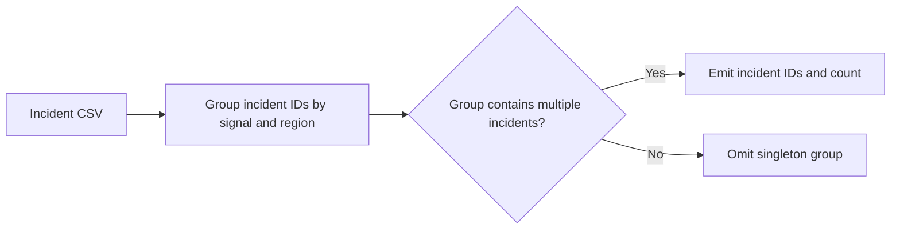

# AI Incident Correlation Engine

Responders handling simultaneous incidents need to see which records share a signal and region so they can investigate related reports together.

## What I built

I built a rule-based AIOps utility that groups incident IDs by the combination of signal and region. Groups with a single record are omitted so the output highlights candidates for joint investigation.

## How it works



[Architecture](docs/ARCHITECTURE.md) · [Decision rules and source](docs/RULES.md)

## Tools used

| Tool | Role in this repository |
| --- | --- |
| Python | [incident_correlation.py](incident_correlation.py) implements the CLI and decision rules. Uses `collections` to group or count records, `csv` to read tabular exports. |
| Make | Runs the documented example and the local `unittest` suite. |
| Python replay runner | Compares actual stdout with the checked-in baseline fixtures. |
| Ruff and Bandit | Developer lint and static security checks through `make check`. |

## Run the project

Use Python 3.10+ and Make. From the repository root:

```sh
python3 incident_correlation.py sample_incidents.csv
```

INC-101 and INC-103 appear together under the Kafka lag signal in us-east. [Full expected output](examples/Demo%201.stdout.txt)

### Additional replay cases

- **Last sample record in isolation** · `python3 incident_correlation.py examples/last-record.csv` · [Expected output](examples/Last%20sample%20record%20in%20isolation.stdout.txt)

## Verify the project

```sh
make verify
make replay
```

`make replay` checks the recorded cases and exits nonzero if the output changes.
See the [developer guide](docs/DEVELOPMENT.md) for the pinned lint and security tools.

## Operating limits

Shared labels are evidence for correlation only. The program does not infer causality or use a trained model.

[Case study](docs/CASE_STUDY.md) · [Operator runbook](docs/RUNBOOK.md) · [Verification report](reports/verification.md)
