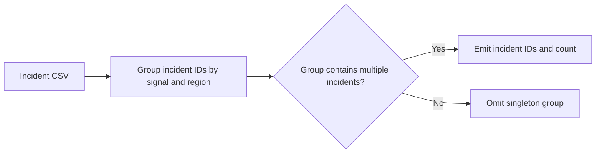

# Ai Incident Correlation Engine architecture

Groups AI platform incidents by shared signals so SREs can spot common causes across models, jobs, and services.

## Operational boundaries

The documented run evaluates the bundled sample locally. Results depend on the quality and scope of the input. The demo makes no live infrastructure changes.
